# HB_E2String 벤치마크

`Enum.ToString()` · `Enum.TryParse()` · `Enum.IsDefined()` · `Enum.GetValues()`와 E2String 생성 코드를 Unity 7 플레이어(IL2CPP · CoreCLR)에서 비교한 결과입니다.

| 항목 | 값 |
|---|---|
| 측정 대상 | `Plugins/EString.dll` (빌드 2026-10-15 21:17, SHA-256 `47b624f2719f…`) |
| Unity | 7000.0.0a8, Windows x64 Standalone |
| 측정일 | 2026-10-15 |
| 패키지 | [HB_E2String](../../HB_E2String/README.md) |
| 측정 코드 | 작업 프로젝트의 `Assets/Benchmarks/E2String/` (UPM 패키지에는 포함되지 않음, [7절](#7-측정-방법과-실행-코드) 참고) |

> DLL이 교체되면 수치가 달라질 수 있습니다. 재측정 시 위 표를 함께 갱신하세요.

## 목차

1. [요약](#1-요약)
2. [결과 비교 (IL2CPP · CoreCLR)](#2-결과-비교-il2cpp--coreclr)
3. [그래프](#3-그래프)
4. [기존 코드의 문제점과 원인](#4-기존-코드의-문제점과-원인)
5. [전 · 후 코드와 생성 코드](#5-전--후-코드와-생성-코드)
6. [트레이드오프](#6-트레이드오프)
7. [측정 방법과 실행 코드](#7-측정-방법과-실행-코드)
8. [부록](#부록)

---

## 1. 요약

| | IL2CPP | CoreCLR |
|---|---|---|
| **Enum → String** | 약 **5배** 빠름 (할당은 원래 없음) | 약 **4배** 빠름, 24 B → **0 B** |
| **String → Enum** | 약 **48배** 빠름 | 약 **11배** 빠름 |
| **정의 검사** | 약 **136배** 빠름, 20 B → **0 B** | 약 **35배** 빠름, 24 B → **0 B** |
| **값 순회** | 약 **230배** 빠름, 44.6 B → **0 B** | 약 **32배** 빠름, 4.6 B → **0 B** |
| **비용** | Enum(100 멤버) 1개당 `GameAssembly.dll` 약 **+19 KB** | Enum 1개당 IL 약 +7.6 KB |

- **IL2CPP에서 E2String의 이득은 주로 속도입니다.** IL2CPP에서는 `Enum.ToString()`과 `Enum.TryParse`가 원래 할당하지 않습니다 (Profiler 캡처로 교차 확인).
- **할당이 0이 되는 곳** (두 런타임 공통): `Enum.IsDefined`, `Enum.GetValues` 순회, `[Flags]` 조합 출력, 문자열 보간의 박싱.
- **주의할 곳**: `[Flags]` 조합의 **첫 호출**은 기존보다 5~9배 느립니다 (조합마다 1회, 이후 캐시).

## 2. 결과 비교 (IL2CPP · CoreCLR)

호출 1회당 시간입니다. **시간은 Release 플레이어, 할당은 Development 플레이어** 기준입니다.

### 2-1. 시간

| 케이스 | IL2CPP 기존 | IL2CPP E2String | 배수 | CoreCLR 기존 | CoreCLR E2String | 배수 |
|---|---:|---:|---:|---:|---:|---:|
| **Enum → String** | | | | | | |
| 100 멤버, 순서대로 | 55.6 ns | **11.2 ns** | ×5.0 | 7.0 ns | **1.9 ns** | ×3.7 |
| 100 멤버, 무작위 순서 | 55.5 ns | **11.1 ns** | ×5.0 | 7.0 ns | **1.2 ns** | ×5.8 |
| 100 멤버, 띄엄띄엄한 값 | 71.4 ns | **5.5 ns** | ×13 | 13.8 ns | **3.4 ns** | ×4.1 |
| 8 멤버 | 55.9 ns | **10.0 ns** | ×5.6 | 7.0 ns | **1.0 ns** | ×7.0 |
| 문자열 보간 `$"S:{e}"` | 174.4 ns | **45.7 ns** | ×3.8 | 26.6 ns | **11.6 ns** | ×2.3 |
| `[Flags]` 조합 | 188.1 ns | **60.9 ns** | ×3.1 | 27.5 ns | **7.4 ns** | ×3.7 |
| **String → Enum** | | | | | | |
| 100 멤버, 성공 | 765.4 ns | **16.1 ns** | ×48 | 71.8 ns | **6.7 ns** | ×11 |
| 100 멤버, 실패 입력 | 801.4 ns | **16.3 ns** | ×49 | 67.2 ns | **5.1 ns** | ×13 |
| 8 멤버, 성공 | 222.3 ns | **5.8 ns** | ×38 | 7.9 ns | **3.3 ns** | ×2.4 |
| **검사 · 순회** | | | | | | |
| 정의 검사 | 149.2 ns | **1.1 ns** | ×136 | 10.5 ns | **0.3 ns** | ×35 |
| 전체 값 순회 (원소당) | 183.9 ns | **0.8 ns** | ×230 | 6.5 ns | **0.2 ns** | ×32 |

- 기존: `ToString()` · `Enum.TryParse` · `Enum.IsDefined(Type, object)` · `foreach Enum.GetValues(Type)`
- E2String: `ToStringFast()` · `To{Enum}Fast(string)` · `IsDefinedFast(T)` · `for Values[i]`

### 2-2. 할당 (호출 1회당)

| 케이스 | IL2CPP 기존 | IL2CPP E2String | CoreCLR 기존 | CoreCLR E2String |
|---|---:|---:|---:|---:|
| Enum → String | 0 B | 0 B | 24 B | **0 B** |
| 문자열 보간 `$"S:{e}"` | 64 B | **44 B** | 64 B | **40 B** |
| `[Flags]` 조합 → String | 47.1 B | **0 B** | 67.1 B | **0 B** |
| String → Enum | 0 B | 0 B | 0 B | 0 B |
| 정의 검사 | 20 B | **0 B** | 24 B | **0 B** |
| 전체 값 순회 (원소당) | 44.6 B | **0 B** | 4.6 B | **0 B** |

문자열 보간의 E2String 쪽 할당(40~44 B)은 결과 문자열 자체입니다. 기존 쪽은 여기에 박싱이 더해집니다.

### 2-3. `[Flags]` 조합의 첫 호출

`ToStringFast`는 `[Flags]` 조합 문자열을 **조합마다 첫 호출에서 만들어 캐시**합니다. 위 반복 측정에는 이 비용이 보이지 않으므로, 아직 캐시되지 않은 조합 255개를 측정 시작 전에 따로 쟀습니다. 타입 초기화 등 첫 호출 비용이 함께 들어간 1회 측정값입니다.

| 런타임 | 기존 `ToString()` | E2String `ToStringFast()` |
|---|---:|---:|
| IL2CPP | 425 ns / 4,093 B | 3,919 ns / 326 B |
| CoreCLR | 415 ns / 5,694 B | 1,982 ns / 299 B |

- 첫 호출은 E2String이 약 5~9배 느립니다 (문자열 조립 + 캐시 등록 + `lock`). 이후 호출은 할당 없이 2-1의 속도로 동작합니다.
- 기존 쪽의 큰 할당(4~6 KB)에는 런타임의 Enum 메타데이터 초기화가 섞여 있습니다.

## 3. 그래프

주황 = 기존 API, 파랑 = E2String. 막대가 겹쳐 그려지므로 **주황 막대 안의 파랑 막대가 E2String**입니다. 값은 [2-1 표](#2-1-시간)와 같습니다.

### IL2CPP — Enum → String (ns, 낮을수록 좋음)

```mermaid
%%{init: {"themeVariables": {"xyChart": {"plotColorPalette": "#eb6834, #2a78d6"}}}}%%
xychart-beta
    title "IL2CPP: Enum -> String (ns/call)"
    x-axis ["100 순서", "100 무작위", "100 띄엄", "8 멤버", "보간", "Flags"]
    y-axis "ns" 0 --> 200
    bar [55.6, 55.5, 71.4, 55.9, 174.4, 188.1]
    bar [11.2, 11.1, 5.5, 10.0, 45.7, 60.9]
```



### IL2CPP — 파싱 · 검사 · 순회 (ns, 낮을수록 좋음)

```mermaid
%%{init: {"themeVariables": {"xyChart": {"plotColorPalette": "#eb6834, #2a78d6"}}}}%%
xychart-beta
    title "IL2CPP: Parse / IsDefined / Values (ns/call)"
    x-axis ["파싱 성공", "파싱 실패", "8 멤버 파싱", "정의 검사", "값 순회"]
    y-axis "ns" 0 --> 850
    bar [765.4, 801.4, 222.3, 149.2, 183.9]
    bar [16.1, 16.3, 5.8, 1.1, 0.8]
```



### CoreCLR — Enum → String (ns, 낮을수록 좋음)

```mermaid
%%{init: {"themeVariables": {"xyChart": {"plotColorPalette": "#eb6834, #2a78d6"}}}}%%
xychart-beta
    title "CoreCLR: Enum -> String (ns/call)"
    x-axis ["100 순서", "100 무작위", "100 띄엄", "8 멤버", "보간", "Flags"]
    y-axis "ns" 0 --> 30
    bar [7.0, 7.0, 13.8, 7.0, 26.6, 27.5]
    bar [1.9, 1.2, 3.4, 1.0, 11.6, 7.4]
```



### CoreCLR — 파싱 · 검사 · 순회 (ns, 낮을수록 좋음)

```mermaid
%%{init: {"themeVariables": {"xyChart": {"plotColorPalette": "#eb6834, #2a78d6"}}}}%%
xychart-beta
    title "CoreCLR: Parse / IsDefined / Values (ns/call)"
    x-axis ["파싱 성공", "파싱 실패", "8 멤버 파싱", "정의 검사", "값 순회"]
    y-axis "ns" 0 --> 80
    bar [71.8, 67.2, 7.9, 10.5, 6.5]
    bar [6.7, 5.1, 3.3, 0.3, 0.2]
```



### 할당 (B/call, 낮을수록 좋음)

```mermaid
%%{init: {"themeVariables": {"xyChart": {"plotColorPalette": "#eb6834, #2a78d6"}}}}%%
xychart-beta
    title "IL2CPP: GC Alloc (B/call)"
    x-axis ["보간", "Flags", "정의 검사", "값 순회"]
    y-axis "B" 0 --> 70
    bar [64, 47.1, 20, 44.6]
    bar [44, 0, 0, 0]
```

```mermaid
%%{init: {"themeVariables": {"xyChart": {"plotColorPalette": "#eb6834, #2a78d6"}}}}%%
xychart-beta
    title "CoreCLR: GC Alloc (B/call)"
    x-axis ["ToString", "보간", "Flags", "정의 검사", "값 순회"]
    y-axis "B" 0 --> 70
    bar [24, 64, 67.1, 24, 4.6]
    bar [0, 40, 0, 0, 0]
```





IL2CPP에서 `ToString()`과 `Enum.TryParse`, CoreCLR에서 `Enum.TryParse`는 원래 할당이 없어 그래프에서 뺐습니다.

## 4. 기존 코드의 문제점과 원인

| 기존 API | IL2CPP | CoreCLR | 원인 |
|---|---|---|---|
| `Enum.ToString()` | 느림 (약 56 ns) | 24 B 할당 (박싱) | `System.Enum`의 가상 메서드 호출 → 런타임 메타데이터에서 이름 조회 |
| `Enum.TryParse` / `Parse` | **매우 느림** (약 770 ns) | 약 70 ns | `Type` 기반 메타데이터 탐색, 대소문자 · 공백 · 쉼표(`[Flags]`) 처리 |
| `Enum.IsDefined(Type, object)` | 약 150 ns, 20 B | 약 11 ns, 24 B | 시그니처가 `object`라 호출 시점에 박싱 |
| `Enum.GetValues(Type)` 순회 | 원소당 약 184 ns, 44.6 B | 원소당 6.5 ns, 4.6 B | 호출마다 새 배열 생성 + `foreach`에서 원소를 `object`로 꺼냄 |
| `$"{e}"` (C# 9) | 64 B | 64 B | `string.Format(string, object)`로 컴파일 → 박싱 후 내부에서 `ToString()` |

E2String은 이 작업을 컴파일 시점에 `switch` 문으로 펼쳐 두어, 런타임 메타데이터 조회 · 박싱 · 배열 생성이 없습니다.

## 5. 전 · 후 코드와 생성 코드

### 사용 코드

```csharp
// 전
string s  = state.ToString();                                        // 메타데이터 조회 (CoreCLR은 박싱)
var e     = (CharacterState)Enum.Parse(typeof(CharacterState), s);   // 메타데이터 탐색
bool ok   = Enum.IsDefined(typeof(CharacterState), raw);             // 박싱
foreach (CharacterState v in Enum.GetValues(typeof(CharacterState))) { }  // 배열 생성 + 박싱

// 후 — [E2String(E2StringOptions.All)]
string s  = state.ToStringFast();
var e     = s.ToCharacterStateFast(fallback: CharacterState.Idle);   // 실패 시 fallback 반환
bool ok   = CharacterStateExtensions.IsDefinedFast(raw);
var all   = CharacterStateExtensions.Values;
for (int i = 0; i < all.Length; i++) { }                             // GC 0
```

### 생성 코드 (실제 출력)

벤치마크의 8 멤버 Enum에서 생성된 코드입니다. 대소문자 무시(`ignoreCase` 매개변수와 `TryMatchName`)는 제거 예정이라 생략했습니다.

```csharp
[E2String(E2StringOptions.All)]
public enum BenchEnum8 { Idle, Walk, Run, Jump, Fall, Attack, Hit, Die }
```

```csharp
// <auto-generated/>
public static class BenchEnum8Extensions
{
    // Collections
    public static readonly BenchEnum8[] Values = new BenchEnum8[]
    {
        (BenchEnum8)(0), (BenchEnum8)(1), (BenchEnum8)(2), (BenchEnum8)(3),
        (BenchEnum8)(4), (BenchEnum8)(5), (BenchEnum8)(6), (BenchEnum8)(7),
    };

    // Enum -> String (항상 생성)
    public static string ToStringFast(this BenchEnum8 value, string fallback = "not defined BenchEnum8")
    {
        switch ((int)value)
        {
            case 0: return "Idle";
            case 1: return "Walk";
            case 2: return "Run";
            case 3: return "Jump";
            case 4: return "Fall";
            case 5: return "Attack";
            case 6: return "Hit";
            case 7: return "Die";
        }
        return fallback;
    }

    // String -> Enum (항상 생성)
    public static BenchEnum8 ToBenchEnum8Fast(this string? value, BenchEnum8 fallback = default)
    {
        if (value == null) return fallback;
        switch (value)
        {
            case "Idle": return (BenchEnum8)(0);
            case "Walk": return (BenchEnum8)(1);
            case "Run": return (BenchEnum8)(2);
            case "Jump": return (BenchEnum8)(3);
            case "Fall": return (BenchEnum8)(4);
            case "Attack": return (BenchEnum8)(5);
            case "Hit": return (BenchEnum8)(6);
            case "Die": return (BenchEnum8)(7);
        }
        return fallback;
    }

    // Enum <-> Int (IntConversion)
    public static int ToIntFast(this BenchEnum8 value) => unchecked((int)value);

    public static BenchEnum8 ToBenchEnum8Fast(this int value, BenchEnum8 fallback = default)
        => IsDefinedFast(value) ? unchecked((BenchEnum8)value) : fallback;

    // IsDefined (IntConversion)
    public static bool IsDefinedFast(BenchEnum8 value)
    {
        switch ((int)value)
        {
            case 0: case 1: case 2: case 3: case 4: case 5: case 6: case 7:
                return true;
        }
        return false;
    }

    public static bool IsDefinedFast(int value) { /* 위와 같은 switch */ }
}
```

- 실제 출력은 `global::` 전체 이름, `[MethodImpl(AggressiveInlining)]`, XML 주석을 포함합니다. 읽기 쉽게 줄였습니다.
- 정수 `switch`는 값이 연속이면 점프 테이블, 띄엄띄엄하면 이진 탐색으로 컴파일됩니다. 문자열 `switch`는 해시 + 비교로 컴파일됩니다.

## 6. 트레이드오프

### 6-1. IL2CPP 빌드 크기 · 빌드 시간

100 멤버 Enum 50개를 IL2CPP Release로 클린 빌드해 비교했습니다. (괄호) 안은 Enum 1개당 증가량입니다.

| 변형 | 스트리핑 | `GameAssembly.dll` 증가 | `global-metadata.dat` 증가 | 빌드 시간 |
|---|---|---:|---:|---:|
| E2String 없음 (기준) | Disabled | 37,655,040 B | 10,137,232 B | 131.9 s |
| `[E2String]`, 생성 메서드 미사용 | Disabled | +944,640 B (**+18.9 KB**) | +85,296 B (+1.7 KB) | 124.4 s |
| `All`, 미사용 | Disabled | +971,776 B (+19.4 KB) | +95,592 B (+1.9 KB) | 129.9 s |
| `[E2String]`, 사용 | Disabled | +1,126,400 B (+22.5 KB) | +86,600 B (+1.7 KB) | 128.6 s |
| `All`, 사용 | Disabled | +1,157,632 B (+23.2 KB) | +96,896 B (+1.9 KB) | 124.9 s |
| E2String 없음 (기준) | Low | 35,994,624 B | 9,227,828 B | 121.4 s |
| `[E2String]`, 미사용 | Low | +943,104 B (+18.9 KB) | +85,212 B (+1.7 KB) | 130.4 s |
| `[E2String]`, 사용 | Low | +1,125,376 B (+22.5 KB) | +86,508 B (+1.7 KB) | 125.7 s |

- **쓰지 않는 생성 메서드도 Managed Stripping `Low`에서는 빠지지 않습니다.**
- 옵션 간 차이는 작습니다 (`All`이 기본보다 Enum당 약 0.5 KB). 비용 대부분은 항상 생성되는 문자열 변환입니다.
- 빌드 시간 차이는 같은 조건의 편차(±5초)보다 작아 구분되지 않습니다.
- 이 수치는 `ignoreCase` 분기가 포함된 DLL로 측정했습니다. 제거 후에는 줄어들 것이므로 재측정이 필요합니다 (C# IL 기준 Enum당 약 2.4 KB).

### 6-2. C# 컴파일 시간 (Unity 밖, warm Csc)

| 옵션 | 어셈블리 (Enum 50개) | 컴파일 시간 (Enum 50개) |
|---|---:|---:|
| E2String 없음 | 66 KB | 38 ms |
| `[E2String]` | 447 KB (Enum당 +7.6 KB) | 249 ms (**+211 ms**) |
| `All` | 459 KB (Enum당 +7.9 KB) | 269 ms (**+231 ms**) |

- 생성기 실행 자체는 수 ms입니다. 시간 증가는 대부분 생성된 `switch`를 컴파일하는 비용입니다.
- 생성기는 `ISourceGenerator`(비증분)라 컴파일 및 IDE 편집 시마다 전체 구문 트리를 다시 탐색합니다.

### 6-3. 인게임 메모리 (추정)

| 항목 | 크기 | 생성 시점 |
|---|---|---|
| 이름 문자열 리터럴 | 100 멤버 기준 약 4 KB / Enum | `ToStringFast` · `To{Enum}Fast` 첫 호출 시 |
| `Values` 배열 (`Collections`) | 100 멤버 기준 약 0.4 KB / Enum | 정적 필드 첫 접근 시 |
| `[Flags]` 조합 캐시 | 조합 1개당 약 300 B (2-3) | 조합의 첫 `ToStringFast` 호출 시. 프로세스 종료까지 유지(상한 없음), `lock`으로 보호 |

### 6-4. 동작 제약

| 항목 | 동작 |
|---|---|
| 옵션 | 생략하면 `ParseExact`. 생성자 인자로 지정 (`[E2String(E2StringOptions.All)]`) |
| 기반 형식 | `byte` ~ `ulong` 모두 지원. `IntConversion`에서 int 범위를 벗어난 멤버는 경고 `E2S003`, `ToIntFast()`는 값을 잘라냄 |
| 같은 값의 별칭 | 컴파일 에러 없음. `ToStringFast`는 먼저 선언된 이름 반환, 파싱은 두 이름 모두 허용 |
| `[Flags]` | 조합 값을 `"A, B"`로 출력 · 파싱. 정의된 플래그로 표현할 수 없는 값은 fallback |
| 문자열 비교 | 이름이 정확히 일치해야 함 (대소문자 구분, 앞뒤 공백 · 숫자 문자열 불허) |
| 어트리뷰트 판별 | 이름이 정확히 `E2StringAttribute`(또는 `E2String`)이면 네임스페이스 무관 |
| 생성하지 않는 경우 | 제네릭 타입 안의 enum (`E2S001`), `private` / `protected` (`E2S002`), 생성 클래스 이름 충돌 (`E2S004`) |
| `Values` | 배열이라 외부에서 내용을 바꿀 수 있음. 수정하지 말 것 |

## 7. 측정 방법과 실행 코드

### 7-1. 측정 방법

| 항목 | 값 |
|---|---|
| 코드 위치 | `Assets/Benchmarks/E2String/` — 별도 어셈블리 `HB.E2String.Benchmarks`. `E2S_BENCHMARK` define이 있는 빌드에만 포함 (일반 게임 빌드에는 들어가지 않음) |
| 테스트 Enum | `BenchEnum100` (100 멤버, 0~99 연속) · `BenchSparse100` (100 멤버, 7, 1016, 2025 … 띄엄띄엄) · `BenchEnum8` (8 멤버) · `BenchFlags8` (`[Flags]` 8개). 모두 `[E2String(E2StringOptions.All)]` |
| 입력 | 정의된 값 순서대로 / 고정 시드 무작위 순서 / 실패 입력(`"Missing000"` …) |
| 방식 | 한 프레임에 한 케이스만 실행 (케이스당 10,000회 호출 = 100 라운드 × 100 입력) |
| 시간 | `Stopwatch`. 빈 케이스(Baseline)를 빼고 호출 수로 나눔 |
| 할당 | `ProfilerRecorder`로 `GC Allocated In Frame`을 읽고 Baseline을 뺌 (Development 플레이어 전용) |
| 예열 · 표본 | 최소 5초 · 20 사이클 예열 → 60 사이클 측정의 중앙값 |
| 반복 | IL2CPP 빌드마다 2회, CoreCLR 빌드마다 3회 실행 → 실행별 중앙값의 중앙값 |
| 교차 확인 | IL2CPP Development 플레이어의 Profiler 데이터(`.raw`)를 에디터에서 열어 `E2S.*` 마커별 GC Alloc을 집계 → `ProfilerRecorder` 결과와 일치 |

### 7-2. 실행

메뉴 `Tools > HB > E2String Benchmark`:

| 메뉴 | 출력 |
|---|---|
| `Build IL2CPP Development Player` / `Build IL2CPP Release Player` | `Builds/E2StringBenchmark_IL2CPP_{Dev,Release}/` |
| `Build CoreCLR Development Player` / `Build CoreCLR Release Player` | `Builds/E2StringBenchmark_CoreCLR_{Dev,Release}/` |
| `Measure IL2CPP Size Variants (5 clean builds)` | `Temp/E2StringIl2CppSize.csv` |
| `Measure IL2CPP Size Variants (Stripping Low, 3 clean builds)` | `Temp/E2StringIl2CppSize_StrippingLow.csv` |
| `Run in Editor (Play Mode)` | `Temp/E2StringProfilerBenchmark.csv` |

```bash
# 플레이어 실행 (결과 CSV)
Builds/E2StringBenchmark_IL2CPP_Release/E2StringBenchmark.exe -batchmode -nographics -e2sOut result.csv

# Development 플레이어에서 Profiler 데이터도 기록 (Profiler 창에서 열기)
Builds/E2StringBenchmark_IL2CPP_Dev/E2StringBenchmark.exe -batchmode -nographics -e2sOut result.csv -e2sProfileLog capture.raw

# 에디터 없이 빌드 (배치 모드)
Unity.exe -batchmode -quit -projectPath . -executeMethod HB.E2String.Benchmarks.Editor.E2StringProfilerBenchmarkBuild.BuildIl2CppRelease
```

빌드 스크립트는 스크립팅 백엔드(크기 측정은 스트리핑 수준도)를 잠시 바꿨다가 되돌립니다. 이때 에디터가 `ProjectSettings`를 다시 저장할 수 있으니 커밋 전에 확인하세요.

### 7-3. 측정 코드 (핵심)

케이스 정의 — 기존과 E2String을 같은 루프 구조로 감쌉니다:

```csharp
AddCase("Before.ToString",    () => { for (int r = 0; r < Rounds; r++) for (int i = 0; i < ValueCount; i++) s_StringSink = s_Values[i].ToString(); });
AddCase("After.ToStringFast", () => { for (int r = 0; r < Rounds; r++) for (int i = 0; i < ValueCount; i++) s_StringSink = s_Values[i].ToStringFast(); });

AddCase("Before.EnumTryParse", () => { for (int r = 0; r < Rounds; r++) for (int i = 0; i < ValueCount; i++) Enum.TryParse(s_Names[i], out s_EnumSink); });
AddCase("After.ToEnumFast",    () => { for (int r = 0; r < Rounds; r++) for (int i = 0; i < ValueCount; i++) s_EnumSink = s_Names[i].ToBenchEnum100Fast(); });

AddCase("Before.EnumIsDefined", () => { for (int r = 0; r < Rounds; r++) for (int i = 0; i < ValueCount; i++) s_BoolSink = Enum.IsDefined(typeof(BenchEnum100), s_Values[i]); });
AddCase("After.IsDefinedFast",  () => { for (int r = 0; r < Rounds; r++) for (int i = 0; i < ValueCount; i++) s_BoolSink = BenchEnum100Extensions.IsDefinedFast(s_Values[i]); });
```

프레임 루프 — 한 프레임에 한 케이스만 실행하고, 다음 프레임에 직전 프레임의 GC 값을 그 케이스에 기록합니다:

```csharp
private void Update()
{
    // 직전 프레임에 실행한 케이스의 기록 (Recorder.LastValue = 직전 프레임 값)
    if (m_PrevCaseIndex >= 0 && m_PrevMeasured)
    {
        var prev = m_Cases[m_PrevCaseIndex];
        prev.TimeNs.Add(prev.LastTimeNs);
        if (m_GcBytesRecorder.Valid) prev.GcBytes.Add(m_GcBytesRecorder.LastValue);
    }

    int index = m_Frame % m_Cases.Count;
    // ... 사이클 경계에서 예열 종료 · 측정 종료 판정 ...

    var current = m_Cases[index];
    using (current.Marker.Auto())           // Profiler 창에서 "E2S.<케이스>"로 보임
    {
        m_Stopwatch.Restart();
        current.Body();                     // 10,000회 호출
        m_Stopwatch.Stop();
    }
    current.LastTimeNs = m_Stopwatch.Elapsed.TotalMilliseconds * 1e6;
    m_PrevCaseIndex = index;
    m_Frame++;
}
```

- 호출 결과는 정적 필드(`s_StringSink` 등)에 저장해 컴파일러가 호출을 제거하지 못하게 합니다.
- 샘플 리스트는 용량을 미리 잡아, 측정 중 리스트 확장 할당이 GC 값에 섞이지 않게 합니다.
- 전체 코드: `Assets/Benchmarks/E2String/E2StringProfilerBenchmark.cs`, 빌드: `Assets/Benchmarks/E2String/Editor/E2StringProfilerBenchmarkBuild.cs`

---

## 부록

### 부록 A. Unity 6.x (Mono)

Unity 6000.3.23f1 내장 Mono 6.13을 Unity 밖에서 실행해 측정했습니다 (`--optimize=all`, C# 9, 할당은 `GC.GetAllocatedBytesForCurrentThread()`). Mono에서는 기존 API가 대부분 할당하므로 **GC 제거 효과가 큽니다.**

| 케이스 | 기존 | E2String | 배수 |
|---|---:|---:|---:|
| Enum → String | 452 ns / 32 B | **3.5 ns / 0 B** | ×130 |
| 문자열 보간 `$"S:{e}"` | 592 ns / 64 B | **41.9 ns / 32 B** | ×14 |
| 미정의 값 → String | 483 ns / 56 B | **0.5 ns / 0 B** | fallback 반환 |
| `[Flags]` 조합 → String | 665 ns / 152 B | **27.1 ns / 0 B** | ×25 |
| String → Enum | 2,169 ns / 56 B | **51 ns / 0 B** | ×43 |
| `[Flags]` 조합 파싱 | 718 ns / 210 B | **198 ns / 0 B** | ×3.6 |
| 정의 검사 | 336 ns / 32 B | **0.5 ns / 0 B** | ×670 |
| Enum → int (`Convert.ToInt32`) | 52 ns / 32 B | **0.5 ns / 0 B** | 박싱 제거 |
| int → Enum (검사 포함) | 142 ns / 16 B | **0.5 ns / 0 B** | ×280 |
| 전체 값 순회 (원소당) | 194 ns / 36.6 B | **0.3 ns / 0 B** | ×650 |

매 프레임 `ToString()`을 100회 호출하면 60fps 기준 초당 약 192 KB의 가비지가 생깁니다. E2String을 쓰면 0입니다.

### 부록 B. Development 플레이어 시간

본문 시간은 Release 플레이어 기준입니다. Development 플레이어 값은 아래와 같습니다. CoreCLR Development는 기존 API가 크게 느려지므로 비교에 쓰지 마세요.

| 케이스 | IL2CPP 기존 | IL2CPP E2String | CoreCLR 기존 | CoreCLR E2String |
|---|---:|---:|---:|---:|
| Enum → String (100 순서) | 41.7 ns | 10.6 ns | 38.5 ns | 1.9 ns |
| 문자열 보간 | 172.7 ns | 50.7 ns | 90.4 ns | 43.4 ns |
| `[Flags]` 조합 | 180.2 ns | 52.4 ns | 89.5 ns | 7.5 ns |
| String → Enum (성공) | 715.5 ns | 14.5 ns | 72.2 ns | 6.9 ns |
| 정의 검사 | 139.3 ns | 1.1 ns | 42.1 ns | 0.3 ns |
| 전체 값 순회 (원소당) | 180.0 ns | 0.8 ns | 7.3 ns | 0.2 ns |

### 부록 C. 에디터 (참고)

Unity 7 에디터(.NET 10 CoreCLR, 스크립트 최적화 Debug, Profiler 녹화 중)에서 Profiler 캡처로 집계한 값입니다. 절대값이 크므로 상대 비교용으로만 보세요.

| 케이스 | 기존 | E2String |
|---|---:|---:|
| Enum → String | 95.1 ns / 24.5 B | 13.3 ns / 0 B |
| 문자열 보간 | 224.8 ns / 64 B | 104.9 ns / 40 B |
| `[Flags]` 조합 → String | 214.9 ns / 67.2 B | 23.4 ns / 0 B |
| String → Enum | 173.5 ns / 0 B | 30.9 ns / 0 B |
| 정의 검사 | 125.1 ns / 24 B | 4.2 ns / 0 B |
| 전체 값 순회 (원소당) | 15.5 ns / 4.6 B | 1.5 ns / 0 B |

### 부록 D. 측정 한계

- **플랫폼**: Windows x64만 측정했습니다. 모바일(Android ARM64 IL2CPP)은 추후 측정 예정입니다.
- **편차**: 실행 간 편차(케이스별 중앙값 기준)는 IL2CPP Development 1%, IL2CPP Release 7%, CoreCLR Release 6%, CoreCLR Development 26%이고, 일부 케이스는 최대 89~164%까지 벌어졌습니다. 배수는 대략적인 크기로 보세요.
- **스트리핑**: `Disabled` · `Low`만 측정했습니다. `Medium` · `High`에서는 미사용 생성 코드가 빠질 수 있습니다.
- **대소문자 무시 파싱**: 제거 예정이라 본문에서 뺐습니다. 측정 당시에는 이득이 없었습니다 (IL2CPP 686 → 717 ns, CoreCLR 120 → 325 ns).
- **입력 패턴**: 무작위 순서 · 실패 입력 · 작은 Enum · 띄엄띄엄한 값을 포함했지만, 실제 게임의 호출 분포와는 다를 수 있습니다.
