# HB_E2String 벤치마크

`Enum.ToString()` · `Enum.TryParse()` · `Enum.IsDefined()` · `Enum.GetValues()`와 E2String 생성 코드를 Unity 7 IL2CPP 플레이어에서 비교한 결과입니다.

| 항목 | 값 |
|---|---|
| 측정 대상 | `Plugins/EString.dll` (빌드 2026-10-18 00:49, SHA-256 `cf2220a5bbd1…`) |
| Unity | 7000.0.0a8, Windows x64 Standalone, IL2CPP |
| 측정일 | 2026-10-22 |
| 패키지 | [HB_E2String](../../HB_E2String/README.md) |
| 측정 코드 | 이 보고서와 같은 폴더 (`Assets/Tools/Benchmarks/E2String/`, UPM 패키지에는 포함되지 않음, [측정 방법과 실행 코드](#7-측정-방법과-실행-코드) 참고) |

> DLL이 교체되면 수치가 달라질 수 있습니다. 재측정 시 위 표를 함께 갱신하세요.
>
> CoreCLR 측정은 Unity 7.0 정식 출시 이후 예정입니다.

## 목차

1. [요약](#1-요약)
2. [결과 비교 (IL2CPP)](#2-결과-비교-il2cpp)
3. [그래프](#3-그래프)
4. [기존 코드의 문제점과 원인](#4-기존-코드의-문제점과-원인)
5. [전 · 후 코드와 생성 코드](#5-전--후-코드와-생성-코드)
6. [트레이드오프](#6-트레이드오프)
7. [측정 방법과 실행 코드](#7-측정-방법과-실행-코드)
8. [부록](#부록)

---

## 1. 요약

| | IL2CPP |
|---|---|
| **Enum → String** | 약 **4배** 빠름 (할당은 원래 없음) |
| **String → Enum** | 약 **45배** 빠름 |
| **정의 검사** | **100배 이상** 빠름, 20 B → **0 B** |
| **값 순회** | **100배 이상** 빠름, 44.6 B → **0 B** |
| **비용** | Enum(100 멤버) 1개당 `GameAssembly.dll` 약 **+11 KB** (Stripping `Low`, 생성 메서드 미사용). `Medium` 이상에서 쓰지 않는 Enum은 **0** |

- **IL2CPP에서 E2String의 이득은 주로 속도입니다.** IL2CPP에서는 `Enum.ToString()`과 `Enum.TryParse`가 원래 할당하지 않습니다.
- **할당이 0이 되는 곳**: `Enum.IsDefined`, `Enum.GetValues` 순회, `[Flags]` 조합 출력. 문자열 보간은 박싱이 빠져 64 B → 44 B(결과 문자열만)가 됩니다.
- **주의할 곳**: `[Flags]` 조합의 **첫 호출**은 기존보다 약 3배 느립니다 (조합마다 1회, 이후 캐시).

## 2. 결과 비교 (IL2CPP)

호출 1회당 시간입니다. **시간은 Release 플레이어, 할당은 Development 플레이어** 기준입니다.

### 2-1. 시간

| 케이스 | 기존 | E2String | 배수 |
|---|---:|---:|---:|
| **Enum → String** | | | |
| 100 멤버, 순서대로 | 43.4 ns | **11.0 ns** | ×4.0 |
| 100 멤버, 무작위 순서 | 43.0 ns | **10.9 ns** | ×4.0 |
| 100 멤버, 띄엄띄엄한 값 | 62.5 ns | **5.2 ns** | ×12 |
| 8 멤버 | 41.8 ns | **9.9 ns** | ×4.2 |
| 문자열 보간 `$"S:{e}"` | 169.8 ns | **45.9 ns** | ×3.7 |
| `[Flags]` 조합 | 175.2 ns | **52.4 ns** | ×3.3 |
| **String → Enum** | | | |
| 100 멤버, 성공 | 726.9 ns | **16.3 ns** | ×45 |
| 100 멤버, 실패 입력 | 760.6 ns | **18.3 ns** | ×42 |
| 8 멤버, 성공 | 181.6 ns | **4.8 ns** | ×38 |
| **검사 · 순회** | | | |
| 정의 검사 | 134.0 ns | **0.7 ns** | ×190 |
| 전체 값 순회 (원소당) | 168.0 ns | **0.7 ns** | ×250 |

- 기존: `ToString()` · `Enum.TryParse` · `Enum.IsDefined(Type, object)` · `foreach Enum.GetValues(Type)`
- E2String: `ToStringFast()` · `To{Enum}Fast(string)` · `IsDefinedFast(T)` · `for Values[i]`
- 1 ns 미만 값(정의 검사 · 값 순회의 E2String 쪽)은 측정 루프 비용 수준이라 배수는 참고용입니다.

### 2-2. 할당 (호출 1회당)

| 케이스 | 기존 | E2String |
|---|---:|---:|
| Enum → String | 0 B | 0 B |
| 문자열 보간 `$"S:{e}"` | 64 B | **44 B** |
| `[Flags]` 조합 → String | 47.1 B | **0 B** |
| String → Enum | 0 B | 0 B |
| 정의 검사 | 20 B | **0 B** |
| 전체 값 순회 (원소당) | 44.6 B | **0 B** |

문자열 보간의 E2String 쪽 할당(44 B)은 결과 문자열 자체입니다. 기존 쪽은 여기에 박싱이 더해집니다.

### 2-3. `[Flags]` 조합의 첫 호출

`ToStringFast`는 `[Flags]` 조합 문자열을 **조합마다 첫 호출에서 만들어 캐시**합니다.
위 반복 측정에는 이 비용이 보이지 않으므로, 아직 캐시되지 않은 조합 255개를 측정 시작 전에 따로 쟀습니다.
타입 초기화 등 첫 호출 비용이 함께 들어간 1회 측정값입니다 (시간은 Release, 할당은 Development, 실행 2회의 중앙값).

| | 기존 `ToString()` | E2String `ToStringFast()` |
|---|---:|---:|
| IL2CPP | 270 ns / 4,147 B | 876 ns / 290 B |

- 첫 호출은 E2String이 약 3배 느립니다 (문자열 조립 + 캐시 등록 + `lock`). 1회 측정이라 실행 간 편차가 큽니다 (E2String 694 ~ 1,058 ns). 이후 호출은 할당 없이 2-1의 속도로 동작합니다.
- 기존 쪽의 큰 할당(약 4 KB)에는 런타임의 Enum 메타데이터 초기화가 섞여 있습니다.

## 3. 그래프

주황 = 기존 API, 파랑 = E2String. 막대가 겹쳐 그려지므로 **주황 막대 안의 파랑 막대가 E2String**입니다. 값은 [2-1 표](#2-1-시간)와 같습니다.

### Enum → String (ns, 낮을수록 좋음)

```mermaid
%%{init: {"themeVariables": {"xyChart": {"plotColorPalette": "#eb6834, #2a78d6"}}}}%%
xychart-beta
    title "IL2CPP: Enum -> String (ns/call)"
    x-axis ["100 순서", "100 무작위", "100 띄엄", "8 멤버", "보간", "Flags"]
    y-axis "ns" 0 --> 200
    bar [43.4, 43.0, 62.5, 41.8, 169.8, 175.2]
    bar [11.0, 10.9, 5.2, 9.9, 45.9, 52.4]
```



### 파싱 · 검사 · 순회 (ns, 낮을수록 좋음)

```mermaid
%%{init: {"themeVariables": {"xyChart": {"plotColorPalette": "#eb6834, #2a78d6"}}}}%%
xychart-beta
    title "IL2CPP: Parse / IsDefined / Values (ns/call)"
    x-axis ["파싱 성공", "파싱 실패", "8 멤버 파싱", "정의 검사", "값 순회"]
    y-axis "ns" 0 --> 800
    bar [726.9, 760.6, 181.6, 134.0, 168.0]
    bar [16.3, 18.3, 4.8, 0.7, 0.7]
```



### 할당 (B/call, 낮을수록 좋음)

```mermaid
%%{init: {"themeVariables": {"xyChart": {"plotColorPalette": "#eb6834, #2a78d6"}}}}%%
xychart-beta
    title "IL2CPP: GC Alloc (B/call)"
    x-axis ["보간", "Flags", "정의 검사", "값 순회"]
    y-axis "B" 0 --> 70
    bar [64, 47.1, 20, 44.6]
    bar [44, 0, 0, 0]
```



`ToString()`과 `Enum.TryParse`는 원래 할당이 없어 그래프에서 뺐습니다.

## 4. 기존 코드의 문제점과 원인

| 기존 API | IL2CPP | 원인 |
|---|---|---|
| `Enum.ToString()` | 느림 (약 43 ns) | `System.Enum`의 가상 메서드 호출 → 런타임 메타데이터에서 이름 조회 |
| `Enum.TryParse` / `Parse` | **매우 느림** (약 730 ns) | `Type` 기반 메타데이터 탐색, 대소문자 · 공백 · 쉼표(`[Flags]`) 처리 |
| `Enum.IsDefined(Type, object)` | 약 134 ns, 20 B | 시그니처가 `object`라 호출 시점에 박싱 |
| `Enum.GetValues(Type)` 순회 | 원소당 약 168 ns, 44.6 B | 호출마다 새 배열 생성 + `foreach`에서 원소를 `object`로 꺼냄 |
| `$"{e}"` (C# 9) | 64 B | `string.Format(string, object)`로 컴파일 → 박싱 후 내부에서 `ToString()` |

E2String은 이 작업을 컴파일 시점에 `switch` 문으로 펼쳐 두어, 런타임 메타데이터 조회 · 박싱 · 배열 생성이 없습니다.

## 5. 전 · 후 코드와 생성 코드

### 사용 코드

```csharp
// 전
string s  = state.ToString();                                        // 메타데이터 조회
var e     = (CharacterState)Enum.Parse(typeof(CharacterState), s);   // 메타데이터 탐색
bool ok   = Enum.IsDefined(typeof(CharacterState), raw);             // 박싱
foreach (CharacterState v in Enum.GetValues(typeof(CharacterState))) { }  // 배열 생성 + 박싱

// 후 — [E2String(E2StringOptions.All)]
string s  = state.ToStringFast();
var e     = s.ToCharacterStateFast(fallback: CharacterState.Idle);   // 실패 시 fallback 반환
bool ok   = CharacterStateExtensions.IsDefinedFast(raw);
var all   = CharacterStateExtensions.Values;
for (int i = 0; i < all.Length; i++) { }                             // GC 0
```

### 생성 코드 (실제 출력)

벤치마크의 8 멤버 Enum에서 생성된 코드입니다.

```csharp
[E2String(E2StringOptions.All)]
public enum BenchEnum8 { Idle, Walk, Run, Jump, Fall, Attack, Hit, Die }
```

```csharp
// <auto-generated/>
public static class BenchEnum8Extensions
{
    // Collections
    public static readonly BenchEnum8[] Values = new BenchEnum8[]
    {
        (BenchEnum8)(0), (BenchEnum8)(1), (BenchEnum8)(2), (BenchEnum8)(3),
        (BenchEnum8)(4), (BenchEnum8)(5), (BenchEnum8)(6), (BenchEnum8)(7),
    };

    // Enum -> String (항상 생성)
    public static string ToStringFast(this BenchEnum8 value, string fallback = "not defined BenchEnum8")
    {
        switch ((int)value)
        {
            case 0: return "Idle";
            case 1: return "Walk";
            case 2: return "Run";
            case 3: return "Jump";
            case 4: return "Fall";
            case 5: return "Attack";
            case 6: return "Hit";
            case 7: return "Die";
        }
        return fallback;
    }

    // String -> Enum (항상 생성)
    public static BenchEnum8 ToBenchEnum8Fast(this string? value, BenchEnum8 fallback = default)
    {
        if (value == null) return fallback;
        switch (value)
        {
            case "Idle": return (BenchEnum8)(0);
            case "Walk": return (BenchEnum8)(1);
            case "Run": return (BenchEnum8)(2);
            case "Jump": return (BenchEnum8)(3);
            case "Fall": return (BenchEnum8)(4);
            case "Attack": return (BenchEnum8)(5);
            case "Hit": return (BenchEnum8)(6);
            case "Die": return (BenchEnum8)(7);
        }
        return fallback;
    }

    // Enum <-> Int (IntConversion)
    public static int ToIntFast(this BenchEnum8 value) => unchecked((int)value);

    public static BenchEnum8 ToBenchEnum8Fast(this int value, BenchEnum8 fallback = default)
        => IsDefinedFast(value) ? unchecked((BenchEnum8)value) : fallback;

    // IsDefined (IntConversion)
    public static bool IsDefinedFast(BenchEnum8 value)
    {
        switch ((int)value)
        {
            case 0: case 1: case 2: case 3: case 4: case 5: case 6: case 7:
                return true;
        }
        return false;
    }

    public static bool IsDefinedFast(int value) { /* 위와 같은 switch */ }
}
```

- 실제 출력은 `global::` 전체 이름, `[MethodImpl(AggressiveInlining)]`, XML 주석을 포함합니다. 읽기 쉽게 줄였습니다.
- 정수 `switch`는 값이 연속이면 점프 테이블, 띄엄띄엄하면 이진 탐색으로 컴파일됩니다. 문자열 `switch`는 해시 + 비교로 컴파일됩니다.

## 6. 트레이드오프

### 6-1. IL2CPP 빌드 크기 · 빌드 시간

100 멤버 Enum 50개를 IL2CPP Release로 클린 빌드해 비교했습니다. (괄호) 안은 Enum 1개당 증가량입니다.

| 변형 | 스트리핑 | `GameAssembly.dll` | `global-metadata.dat` | 빌드 시간 |
|---|---|---:|---:|---:|
| E2String 없음 (기준) | Low | 34,358,272 B | 8,953,068 B | 136.2 s |
| `[E2String]`, 생성 메서드 미사용 | Low | +552,960 B (**+11.1 KB**) | +81,056 B (+1.6 KB) | 118.7 s |
| `All`, 미사용 | Low | +577,024 B (+11.5 KB) | +91,808 B (+1.8 KB) | 110.5 s |
| `[E2String]`, 사용 | Low | +735,232 B (+14.7 KB) | +82,360 B (+1.6 KB) | 110.6 s |
| `All`, 사용 | Low | +764,416 B (+15.3 KB) | +93,104 B (+1.9 KB) | 110.5 s |
| E2String 없음 (기준) | Medium | 28,154,880 B | 6,999,700 B | 97.5 s |
| E2String 없음, Enum을 기존 API로 사용 | Medium | +37,888 B | +137,384 B | 92.4 s |
| `[E2String]`, 미사용 | Medium | **+0 B** | +0 B | 96.0 s |
| `[E2String]`, 사용 | Medium | +764,416 B | +218,476 B | 109.4 s |
| └ E2String만 (사용 − 기존 API 사용) | Medium | +726,528 B (**+14.5 KB**) | +81,092 B (+1.6 KB) | |
| E2String 없음 (기준) | High | 29,365,760 B | 7,243,180 B | 125.7 s |
| E2String 없음, Enum을 기존 API로 사용 | High | +37,376 B | +137,388 B | 111.6 s |
| `[E2String]`, 미사용 | High | **+0 B** | +0 B | 97.1 s |
| `[E2String]`, 사용 | High | +764,416 B | +218,476 B | 104.2 s |
| └ E2String만 (사용 − 기존 API 사용) | High | +727,040 B (**+14.5 KB**) | +81,088 B (+1.6 KB) | |

- **`Low`에서는 쓰지 않는 생성 메서드도 빠지지 않습니다.** `Low`는 사용자 어셈블리를 통째로 남기기 때문입니다 (기준 빌드에도 Enum 50개와 멤버 이름 5,000개가 들어 있음).
- **`Medium` · `High`에서는 아무도 참조하지 않는 Enum의 생성 코드가 Enum과 함께 전부 빠집니다** (기준과 바이트까지 같음).
- **생성 코드 자체는 Enum당 약 11 KB이고, 호출하는 코드까지 포함하면 약 14.5 KB입니다** (근사, 스트리핑 단계와 무관).
  - `Low` 미사용(+11.1 KB)이 생성 코드만의 몫입니다.
  - `Medium` · `High`의 "사용" 증가량(+764 KB)에서 같은 값을 `ToString()` · `Enum.TryParse<T>()`로 쓰는 변형을 뺀 값(+14.5 KB)에는 호출 코드 모양 차이(약 3.4 KB)가 더 들어 있습니다.
  - 빼는 변형의 증가분(메타데이터 약 137 KB)은 Enum 자체(멤버 이름 · 상수 5,000개)의 몫입니다.
- 옵션 간 차이는 작습니다 (`All`이 기본보다 Enum당 약 0.5 KB). 비용 대부분은 항상 생성되는 문자열 변환입니다.
- 빌드 시간 차이는 같은 조건의 편차(±10초)보다 작아 구분되지 않습니다 (각 측정의 첫 빌드는 캐시 정리 때문에 더 걸림).
- `High` 기준선이 `Medium`보다 약 1.2 MB 큽니다. 스트리핑 뒤 BCL에 EventSource(트레이싱) · Reflection.Emit · RegexCompiler가 더 남습니다 (7000.0.0a8, 원인 미확인, 다시 빌드해도 바이트까지 같음). E2String 증가량은 `Medium`과 같습니다.
- 측정 조건: 이 저장소의 치트 define(`DEV_CHEAT` · `HB_CHEAT` · `HB_CHEAT_HAS_CONSOLE`)은 측정 동안 껐습니다. `USE_HLOG`는 켜진 상태입니다.

### 6-2. C# 컴파일 시간 (Unity 밖, warm Roslyn)

| 옵션 | 어셈블리 (Enum 50개) | 컴파일 시간 (Enum 50개) | 그중 생성기 실행 |
|---|---:|---:|---:|
| E2String 없음 | 115,200 B (113 KB) | 26 ms | — |
| `[E2String]` | 478,720 B (468 KB, Enum당 +7.1 KB) | 338 ms (**+312 ms**) | 24 ms |
| `All` | 491,520 B (480 KB, Enum당 +7.3 KB) | 433 ms (**+407 ms**) | 27 ms |

- 생성기 실행 자체는 Enum 50개에 약 25 ms(Enum당 약 0.5 ms)입니다. 나머지 증가분은 생성된 코드(`switch` · 문자열 리터럴)를 컴파일하고 Emit하는 비용입니다.
- 생성기는 `IIncrementalGenerator`(증분)입니다.
- 크기는 모든 실행에서 바이트까지 같았습니다. 시간은 라운드 사이 범위가 `[E2String]` 319 ~ 370 ms, `All` 426 ~ 482 ms, 없음 26 ~ 33 ms입니다.
- 측정 방법
  - Unity 7000.0.0a8에 들어 있는 Roslyn 5.6(`DotNetSdk/sdk/10.0.303/Roslyn/bincore`)을 별도 프로세스에서 API로 호출했습니다 (Unity 밖, warm).
  - 입력은 SizeProbe(`E2StringSizeProbe.cs` + `BenchmarkE2StringAttribute.cs`), 참조는 netstandard 2.1 + `Unity.Scripting`, C# 9 · Release · deterministic입니다.
  - 1회 = 파싱 → Compilation 생성 → 생성기 실행 → Emit. 프로세스마다 예열 10회 뒤 20회 중앙값, 5라운드의 중앙값입니다.

### 6-3. 인게임 메모리 (추정)

| 항목 | 크기 | 생성 시점 |
|---|---|---|
| 이름 문자열 리터럴 | 100 멤버 기준 약 4 KB / Enum | `ToStringFast` · `To{Enum}Fast` 첫 호출 시 |
| `Values` 배열 (`Collections`) | 100 멤버 기준 약 0.4 KB / Enum | 정적 필드 첫 접근 시 |
| `[Flags]` 조합 캐시 | 조합 1개당 약 300 B (2-3) | 조합의 첫 `ToStringFast` 호출 시. 프로세스 종료까지 유지(상한 없음), `lock`으로 보호 |

### 6-4. 동작 제약

| 항목 | 동작 |
|---|---|
| 옵션 | 생략하면 `ParseExact`. 생성자 인자로 지정 (`[E2String(E2StringOptions.All)]`) |
| 기반 형식 | `byte` ~ `ulong` 모두 지원. `IntConversion`에서 int 범위를 벗어난 멤버는 경고 `E2S003`, `ToIntFast()`는 값을 잘라냄 |
| 같은 값의 별칭 | 컴파일 에러 없음. `ToStringFast`는 먼저 선언된 이름 반환, 파싱은 두 이름 모두 허용 |
| `[Flags]` | 조합 값을 `"A, B"`로 출력 · 파싱. 정의된 플래그로 표현할 수 없는 값은 fallback |
| 문자열 비교 | 이름이 정확히 일치해야 함 (대소문자 구분, 앞뒤 공백 · 숫자 문자열 불허) |
| 어트리뷰트 판별 | 이름이 정확히 `E2StringAttribute`(또는 `E2String`)이면 네임스페이스 무관 |
| 생성하지 않는 경우 | 제네릭 타입 안의 enum (`E2S001`), `private` / `protected` (`E2S002`), 생성 클래스 이름 충돌 (`E2S004`) |
| `Values` | 배열이라 외부에서 내용을 바꿀 수 있음. 수정하지 말 것 |

## 7. 측정 방법과 실행 코드

### 7-1. 측정 방법

| 항목 | 값 |
|---|---|
| 코드 위치 | `Assets/Tools/Benchmarks/E2String/` — 별도 어셈블리 `HB.E2String.Benchmarks`. `E2S_BENCHMARK` define이 있는 빌드에만 포함 (일반 게임 빌드에는 들어가지 않음) |
| 테스트 Enum | `BenchEnum100` (100 멤버, 0~99 연속) · `BenchSparse100` (100 멤버, 7, 1016, 2025 … 띄엄띄엄) · `BenchEnum8` (8 멤버) · `BenchFlags8` (`[Flags]` 8개). 모두 `[E2String(E2StringOptions.All)]` |
| 입력 | 정의된 값 순서대로 / 고정 시드 무작위 순서 / 실패 입력(`"Missing000"` …) |
| 방식 | 한 프레임에 한 케이스만 실행 (케이스당 10,000회 호출 = 100 라운드 × 100 입력) |
| 시간 | `Stopwatch`. 빈 케이스(Baseline)를 빼고 호출 수로 나눔 |
| 할당 | `ProfilerRecorder`로 `GC Allocated In Frame`을 읽고 Baseline을 뺌 (Development 플레이어 전용) |
| 예열 · 표본 | 최소 5초 · 20 사이클 예열 → 60 사이클 측정의 중앙값 |
| 반복 | 빌드마다 2회 실행 → 실행별 중앙값의 중앙값 |
| 교차 확인 | IL2CPP Development 플레이어의 Profiler 데이터(`.raw`)를 에디터에서 열어 `E2S.*` 마커별 GC Alloc을 집계 → `ProfilerRecorder` 결과와 일치 |

### 7-2. 실행

메뉴 `Tools > HB > E2String Benchmark`:

| 메뉴 | 출력 |
|---|---|
| `Build IL2CPP Development Player` / `Build IL2CPP Release Player` | `Builds/E2StringBenchmark_IL2CPP_{Dev,Release}/` |
| `Build CoreCLR Development Player` / `Build CoreCLR Release Player` (Unity 7.0 정식 출시 이후 측정 예정) | `Builds/E2StringBenchmark_CoreCLR_{Dev,Release}/` |
| `Measure IL2CPP Size Variants (5 clean builds)` | `Temp/E2StringIl2CppSize.csv` |
| `Measure IL2CPP Size Variants (Stripping Low, 3 clean builds)` | `Temp/E2StringIl2CppSize_StrippingLow.csv` |
| `Measure IL2CPP Size Variants (Stripping Medium, 4 clean builds)` | `Temp/E2StringIl2CppSize_StrippingMedium.csv` |
| `Measure IL2CPP Size Variants (Stripping High, 4 clean builds)` | `Temp/E2StringIl2CppSize_StrippingHigh.csv` |
| `Run in Editor (Play Mode)` | `Temp/E2StringProfilerBenchmark.csv` |

```bash
# 플레이어 실행 (결과 CSV)
Builds/E2StringBenchmark_IL2CPP_Release/E2StringBenchmark.exe -batchmode -nographics -e2sOut result.csv

# Development 플레이어에서 Profiler 데이터도 기록 (Profiler 창에서 열기)
Builds/E2StringBenchmark_IL2CPP_Dev/E2StringBenchmark.exe -batchmode -nographics -e2sOut result.csv -e2sProfileLog capture.raw

# 에디터 없이 빌드 (배치 모드)
Unity.exe -batchmode -quit -projectPath . -executeMethod HB.E2String.Benchmarks.Editor.E2StringProfilerBenchmarkBuild.BuildIl2CppRelease
```

빌드 스크립트는 스크립팅 백엔드(크기 측정은 스트리핑 수준도)를 잠시 바꿨다가 되돌립니다. 이때 에디터가 `ProjectSettings`를 다시 저장할 수 있으니 커밋 전에 확인하세요.

- 크기 측정 메뉴는 같은 이름의 출력 폴더(`Builds/E2StringBenchmark_Size_<스트리핑>/<변형>/`)를 지우고 다시 빌드합니다.
- 배치 모드로 실행하면 Unity가 종료하면서 `Temp/`를 정리하므로 CSV가 남지 않습니다. 같은 내용이 `-logFile` 로그에 `[E2S Benchmark] IL2CPP 크기 측정 결과`로 찍히니 로그에서 가져오세요.
- 이 저장소처럼 치트 define이 켜져 있으면 HB_Cheat 릴리스 가드가 Release 빌드를 막습니다. 측정 동안만 define을 끄세요.

### 7-3. 측정 코드 (핵심)

케이스 정의 — 기존과 E2String을 같은 루프 구조로 감쌉니다:

```csharp
AddCase("Before.ToString",    () => { for (int r = 0; r < Rounds; r++) for (int i = 0; i < ValueCount; i++) s_StringSink = s_Values[i].ToString(); });
AddCase("After.ToStringFast", () => { for (int r = 0; r < Rounds; r++) for (int i = 0; i < ValueCount; i++) s_StringSink = s_Values[i].ToStringFast(); });

AddCase("Before.EnumTryParse", () => { for (int r = 0; r < Rounds; r++) for (int i = 0; i < ValueCount; i++) Enum.TryParse(s_Names[i], out s_EnumSink); });
AddCase("After.ToEnumFast",    () => { for (int r = 0; r < Rounds; r++) for (int i = 0; i < ValueCount; i++) s_EnumSink = s_Names[i].ToBenchEnum100Fast(); });

AddCase("Before.EnumIsDefined", () => { for (int r = 0; r < Rounds; r++) for (int i = 0; i < ValueCount; i++) s_BoolSink = Enum.IsDefined(typeof(BenchEnum100), s_Values[i]); });
AddCase("After.IsDefinedFast",  () => { for (int r = 0; r < Rounds; r++) for (int i = 0; i < ValueCount; i++) s_BoolSink = BenchEnum100Extensions.IsDefinedFast(s_Values[i]); });
```

프레임 루프 — 한 프레임에 한 케이스만 실행하고, 다음 프레임에 직전 프레임의 GC 값을 그 케이스에 기록합니다:

```csharp
private void Update()
{
    // 직전 프레임에 실행한 케이스의 기록 (Recorder.LastValue = 직전 프레임 값)
    if (m_PrevCaseIndex >= 0 && m_PrevMeasured)
    {
        var prev = m_Cases[m_PrevCaseIndex];
        prev.TimeNs.Add(prev.LastTimeNs);
        if (m_GcBytesRecorder.Valid) prev.GcBytes.Add(m_GcBytesRecorder.LastValue);
    }

    int index = m_Frame % m_Cases.Count;
    // ... 사이클 경계에서 예열 종료 · 측정 종료 판정 ...

    var current = m_Cases[index];
    using (current.Marker.Auto())           // Profiler 창에서 "E2S.<케이스>"로 보임
    {
        m_Stopwatch.Restart();
        current.Body();                     // 10,000회 호출
        m_Stopwatch.Stop();
    }
    current.LastTimeNs = m_Stopwatch.Elapsed.TotalMilliseconds * 1e6;
    m_PrevCaseIndex = index;
    m_Frame++;
}
```

- 호출 결과는 정적 필드(`s_StringSink` 등)에 저장해 컴파일러가 호출을 제거하지 못하게 합니다.
- 샘플 리스트는 용량을 미리 잡아, 측정 중 리스트 확장 할당이 GC 값에 섞이지 않게 합니다.
- 전체 코드: [`E2StringProfilerBenchmark.cs`](E2StringProfilerBenchmark.cs), 빌드: [`Editor/E2StringProfilerBenchmarkBuild.cs`](Editor/E2StringProfilerBenchmarkBuild.cs)

---

## 부록

### 부록 A. Development 플레이어 시간

본문 시간은 Release 플레이어 기준입니다. Development 플레이어 값은 아래와 같습니다.

| 케이스 | 기존 | E2String |
|---|---:|---:|
| Enum → String (100 순서) | 41.8 ns | 11.0 ns |
| 문자열 보간 | 169.8 ns | 52.7 ns |
| `[Flags]` 조합 | 185.1 ns | 52.4 ns |
| String → Enum (성공) | 724.9 ns | 14.2 ns |
| 정의 검사 | 138.7 ns | 1.1 ns |
| 전체 값 순회 (원소당) | 181.1 ns | 0.9 ns |

### 부록 B. 측정 한계

- **플랫폼**: Windows x64만 측정했습니다. 모바일(Android ARM64 IL2CPP)은 추후 측정 예정입니다.
- **편차**: 두 실행 사이의 차이(케이스별 중앙값 기준)는 Release 0.7%(최대 2.7%), Development 0.9%(최대 5.4%)입니다. `[Flags]` 첫 호출(2-3)은 1회 측정이라 최대 52%까지 벌어졌습니다.
- **스트리핑**: 크기는 `Low` · `Medium` · `High`를 측정했습니다. 속도는 프로젝트 설정(`Low`) 기준입니다.
- **런타임**: IL2CPP만 측정했습니다. CoreCLR은 Unity 7.0 정식 출시 이후 측정 예정입니다.
- **입력 패턴**: 무작위 순서 · 실패 입력 · 작은 Enum · 띄엄띄엄한 값을 포함했지만, 실제 게임의 호출 분포와는 다를 수 있습니다.
